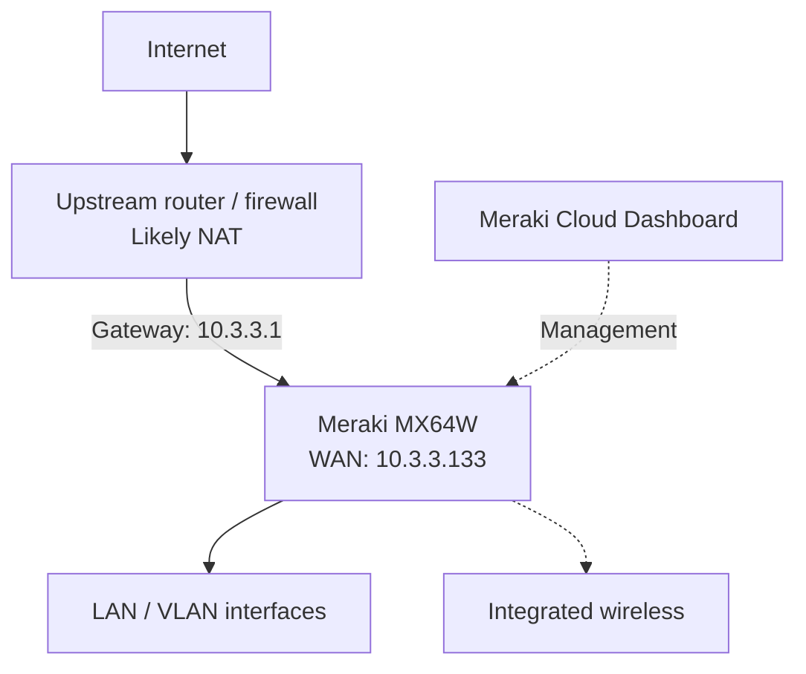

# Cisco Meraki Lab 1 — Dashboard Familiarization and MX64W Monitoring

  

## Overview

This beginner lab introduces the Cisco Meraki cloud-managed Dashboard through network creation, device inventory inspection, and **read-only monitoring** of a physical **Cisco Meraki MX64W** security appliance. It connects foundational CCNA topics—WAN addressing, gateways, NAT, VLANs, DHCP, and connectivity monitoring—to their Dashboard equivalents.

> **Scope and safety:** The MX64W observed during this lab was already assigned to an existing **Branch B** network. It was **not moved** to the newly created training network, and no production configuration changes were performed as part of the documented monitoring steps. Confirm authorization before making changes in an organization you do not exclusively control.

## Objectives

- Access and navigate the Meraki Dashboard.
- Create a separate network using the default Meraki configuration.
- Locate a physical MX appliance in organization inventory.
- Check appliance, WAN, and wireless status.
- Inspect WAN IPv4, IPv6, gateway, and DNS settings.
- Review DHCP subnets and the lease table.
- Interpret findings using CCNA networking concepts.

## Lab Environment

| Item | Details |
|---|---|
| Management platform | Cisco Meraki Dashboard |
| Physical appliance | Cisco Meraki MX64W (integrated wireless) |
| Newly created lab network | `CCNA-training 1` |
| Lab network type | Combined hardware |
| Initial network configuration | Default Meraki configuration |
| Existing appliance network | Branch B (separate from `CCNA-training 1`) |
| Appliance display name | RivanConnect |
| Firmware observed | MX 18.107.10 |
| Access method | Web browser |

> **Note:** The screenshots confirmed the network creation settings and subsequent inventory/monitoring screens. The actual creation of `CCNA-training 1` was reported in the guided workflow but was not independently confirmed by a post-creation screenshot. Check the network selector to verify that it exists.

## Logical Topology (Inferred)



The WAN interface uses a private RFC 1918 IPv4 address, while the Dashboard also displays a public IP. This **suggests** upstream NAT; the upstream router's configuration was not inspected.

## Procedure and Results

### Step 1 — Access the Dashboard

1. Open [dashboard.meraki.com](https://dashboard.meraki.com).
2. Sign in with an authorized account.
3. Select the appropriate organization.
4. Explore the **Organization**, **Network-wide**, and **Security & SD-WAN** navigation areas.

**Result:** Dashboard access and organization visibility confirmed.

### Step 2 — Set Up a Training Network

1. Open the network selector and choose **Create a network**.
2. Enter the following settings:

   | Field | Value |
   |---|---|
   | Network name | `CCNA-training 1` |
   | Network type | `Combined hardware` |
   | Network configuration | `Default Meraki configuration` |
   | Bind to template | Not selected |
   | Clone from existing network | Not selected |

3. When prompted for **Security appliance type**, select **MX based Cisco secure router, MX security appliance** (appropriate for the MX64W).
4. Create the network if authorized, then verify its presence in the network selector.

**Observation:** The creation form did not contain a network-tag field; tags were therefore skipped. No appliance was assigned to the new training network during this lab.

> **Important:** The security appliance type selection may be irreversible for the network. Do not select the IOS XE-based option for an MX64W.

### Step 3 — Inspect Organization Inventory

1. Go to **Organization → Inventory**.
2. Locate the MX64W by model.
3. Review the assigned network and device information.

**Observed results:**

| Field | Observation |
|---|---|
| Device model | MX64W |
| Inventory count shown | 1 device |
| Assigned network | Branch B |
| Device claimed | Yes |

**Interpretation:** The appliance was already assigned to another network. It was intentionally **not reassigned**, to avoid disrupting the existing configuration.

### Step 4 — Verify Appliance Status

1. Open the appliance's existing network (**Branch B**).
2. Navigate to **Security & SD-WAN → Appliance status** (menu labels can vary).
3. Review the **Summary** tab.

| Check | Observation |
|---|---|
| Appliance cloud status | Online (green indicator) |
| WAN | Active |
| LAN ports 1–4 | No active links shown in the screenshot |
| Current clients | 0 |
| Firmware | MX 18.107.10 |
| Firmware update | Available |
| 2.4 GHz channel utilization | 29% — Dashboard labeled *Acceptable* |
| 5 GHz channel utilization | 14% — Dashboard labeled *Acceptable* |

**Interpretation:** The appliance was online and managed by Meraki Dashboard. The available firmware update was **not installed** as part of this lab.

### Step 5 — Inspect WAN Uplink

1. From **Appliance status**, select **Uplink**.
2. Review the IPv4/IPv6 configuration, gateway, DNS, and traffic graphs.
3. Do not edit uplink settings.

| Parameter | Observed value |
|---|---|
| IPv4 configuration | Dynamic |
| IPv4 status | Active |
| WAN IPv4 address | `10.3.3.133` (private) |
| Gateway | `10.3.3.1` |
| DNS server 1 | `8.8.8.8` |
| DNS server 2 | `8.8.4.4` |
| IPv6 configuration | Auto (Stateless) |
| IPv6 status | Not connected |
| Uplink traffic | Activity visible in live graph |

**CCNA interpretation:**

- `10.3.3.133` is an RFC 1918 private IPv4 address.
- The MX receives IPv4 WAN configuration dynamically, typically from an upstream DHCP server.
- `10.3.3.1` is the configured next-hop gateway.
- `8.8.8.8` and `8.8.4.4` are public Google DNS resolvers.
- IPv6 not being connected does not prevent IPv4 operation.
- A public IP shown elsewhere on the Dashboard alongside a private WAN address is consistent with an upstream NAT design, but NAT was not independently verified.

**Related Cisco IOS commands (conceptual comparisons, not commands run on the MX):**

```text
show ip interface brief
show ip route
show interfaces
```

### Step 6 — Inspect DHCP Subnets and Leases

1. From **Appliance status**, select **DHCP**.
2. Review the listed DHCP subnets and VLAN identifiers.
3. Check the lease table.

| VLAN | Subnet | Used leases shown |
|---:|---|---:|
| 1 | `192.168.128.0/24` | 0 |
| 2 | `10.2.0.0/16` | 0 |
| 21 | `172.21.0.0/16` | 0 |
| 22 | `172.22.0.0/16` | 0 |
| 31 | `192.168.31.0/24` | 0 |
| 32 | `192.168.32.0/24` | 0 |
| 41 | `10.0.41.0/24` | 0 |
| 42 | `10.0.42.0/24` | 0 |
| 69 | `192.168.69.0/24` | 0 |
| 100 | `10.100.0.0/16` | 0 |

**Lease table message:** `This device has not issued any DHCP leases`.

**Interpretation:** No leases were recorded in the displayed table at the time of observation. This aligns with the earlier **0 current clients** reading, but **does not prove DHCP is malfunctioning** or that DHCP server mode is enabled on every listed VLAN. Verifying DHCP modes would require checking the actual configuration.

## Troubleshooting Notes

| Observation | Possible explanation | Safe next check |
|---|---|---|
| WAN active, private WAN IP | Upstream router supplies addressing; possible NAT | Inspect authorized upstream topology/documentation |
| No current clients | No wired/wireless clients attached at capture time | Check **Network-wide → Clients** |
| No DHCP leases | No current leases, or DHCP handled elsewhere | Read DHCP settings; do not change them |
| IPv6 not connected | Upstream IPv6 may not be available/configured | Check ISP/upstream IPv6 support if needed |
| Firmware update available | Newer firmware offered | Review compatibility and change window before upgrading |

## Knowledge Check

1. **Why is `10.3.3.133` a private address?** It falls within the RFC 1918 `10.0.0.0/8` block.
2. **What is the role of `10.3.3.1`?** It is the MX's configured WAN default gateway.
3. **Does an empty DHCP lease table prove DHCP failure?** No. There may be no active clients, or another DHCP service may be used.
4. **Can the MX64W be moved into `CCNA-training 1` without risk?** Not necessarily. It is assigned to Branch B; moving it could disrupt the existing network.
5. **What is the difference between an MX and an IOS XE router?** The MX is administered primarily through the Meraki cloud Dashboard, whereas IOS XE routers have a traditional IOS XE management and CLI model.

## Completion Checklist

- [x] Accessed Meraki Dashboard.
- [x] Reviewed training-network creation settings.
- [x] Selected the MX-compatible appliance type.
- [x] Identified the physical MX64W in Inventory.
- [x] Verified online status and WAN activity.
- [x] Reviewed WAN IPv4, gateway, DNS, and IPv6 status.
- [x] Reviewed VLAN/subnet listings and DHCP leases.
- [x] Kept the existing Branch B appliance assignment unchanged.
- [ ] Independently verify that `CCNA-training 1` appears in the network selector.

## Outcome

**Lab 1's device-discovery and read-only monitoring exercises are complete.** The MX64W was confirmed online with an active IPv4 WAN connection, multiple VLAN/subnet entries, and no DHCP leases shown at the time of inspection. The newly prepared training network remains separate from the MX64W's existing Branch B assignment.

**Suggested next lab:** VLAN and DHCP configuration on a **dedicated, authorized test appliance/network**, or a read-only review of existing VLAN settings if Branch B is a production environment.

## References

- [Cisco Meraki Documentation](https://documentation.meraki.com/)
- [Cisco Meraki Dashboard](https://dashboard.meraki.com/)

---

*Documentation based on screenshots and observations from the Lab 1 guided session. Device identifiers, exact site address, hostname, and public IP have been intentionally omitted for safe publication.*
